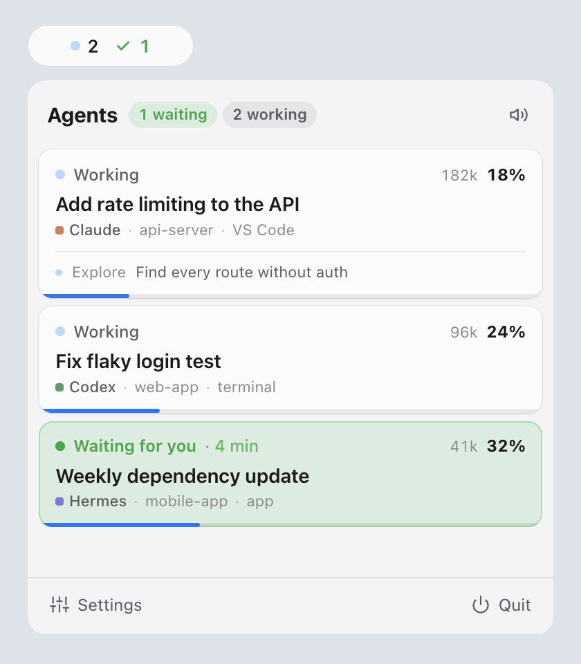

# agent-bar

**A small floating widget for macOS that shows which AI coding agents are working and which are waiting for you.**
Claude Code, Codex and Hermes — all sessions in one list, with a sound when one of them needs you.

[Русская версия](README.ru.md)

<p align="center"></p>

## Why

You start an agent, switch to something else, and forget about it. Twenty minutes later it turns out it finished long ago — or has been stuck on a permission prompt the whole time. With three or four sessions in different windows it gets worse.

agent-bar keeps a small pill on top of all windows: how many sessions are working, how many are waiting for you. Click it to see the list.

- **Doesn't touch your agents.** No hooks, no plugins, no changes to their configs. It only reads the files agents already write to disk.
- **Claude Code, Codex and Hermes** in one place — the terminal, VS Code, the Claude app.
- **Working / waiting for you / needs an answer.** A separate state when an agent stopped mid-turn to ask a question or wait for a permission prompt.
- **A sound** when a session finishes or asks something. Pick your own sounds, mute a single session or everything. No sound for a VS Code window you're already looking at.
- **Context load** for each session, subagents and background tasks under the card.
- **Click a card** to jump to where the session runs: the VS Code window, the Claude app session, the terminal.
- **English and Russian** interface, follows the macOS language by default.

## Install

1. Download the `.dmg` from [Releases](https://github.com/nu-idea/agent-bar/releases/latest):
   [Apple Silicon](https://github.com/nu-idea/agent-bar/releases/latest/download/agent-bar-arm64.dmg) ·
   [Intel](https://github.com/nu-idea/agent-bar/releases/latest/download/agent-bar-x64.dmg)
2. Drag **agent-bar** to Applications.
3. Open it. The first time macOS will block it — see below.

### First launch: "Apple could not verify…"

The app is not signed with a paid Apple Developer certificate, so macOS refuses to open it the first time. Either:

- try to open it once, then go to **System Settings → Privacy & Security**, scroll down and click **Open Anyway** next to agent-bar, then confirm with your password; or
- run once in Terminal:
  ```bash
  xattr -dr com.apple.quarantine /Applications/agent-bar.app
  ```

After that it opens normally. The source is right here if you'd rather [build it yourself](#build-from-source).

## Requirements

- macOS 13 or later, Apple Silicon or Intel
- At least one of: [Claude Code](https://code.claude.com/docs/en/overview), [Codex](https://github.com/openai/codex), [Hermes](https://github.com/NousResearch/hermes-agent)

## Privacy

agent-bar runs fully locally and makes no network requests.

| What | Why |
|---|---|
| reads `~/.claude/projects`, `~/.claude/sessions` | Claude Code sessions and their state |
| reads `~/.codex/sessions` | Codex sessions |
| reads `~/.hermes/state.db` (read-only, via `sqlite3`) | Hermes sessions |
| reads VS Code's `storage.json` | which VS Code window belongs to which folder |
| runs `ps`, `pgrep`, `lsof`, `lsappinfo`, `osascript`, `afplay`, `open` | find where a session runs, which app is in front, play sounds, open a session |
| writes `~/Library/Application Support/agent-bar/` and `~/Library/Logs/agent-bar.log` | its own settings, positions and a debug log |

No macOS permissions are requested: no Accessibility, no Screen Recording.

## FAQ

**How do I switch the language?** Settings → Language: System, English or Русский. System follows the first language in macOS settings.

**Why is it so big?** It's built with Electron: the download is about 120 MB, the installed app about 260 MB. It reads files every 2 seconds and does nothing else.

**A session doesn't show up.** Finished sessions stay in the list for 30 minutes (change it in Settings). Sessions started by scripts (`claude -p`, SDK, `codex exec`) can be hidden in Settings. If something still looks wrong, run `npm run dump` from source — it prints exactly what the widget sees — and open an issue.

**How does it know a session is waiting?** By reading the agent's own session files and, for Claude Code, its session registry. Details: [docs/ARCHITECTURE.md](docs/ARCHITECTURE.md) (in Russian).

## Build from source

```bash
git clone https://github.com/nu-idea/agent-bar.git
cd agent-bar
npm install
npm start          # run
npm run dist       # build .dmg and .zip into dist/
```

## License

[MIT](LICENSE)
