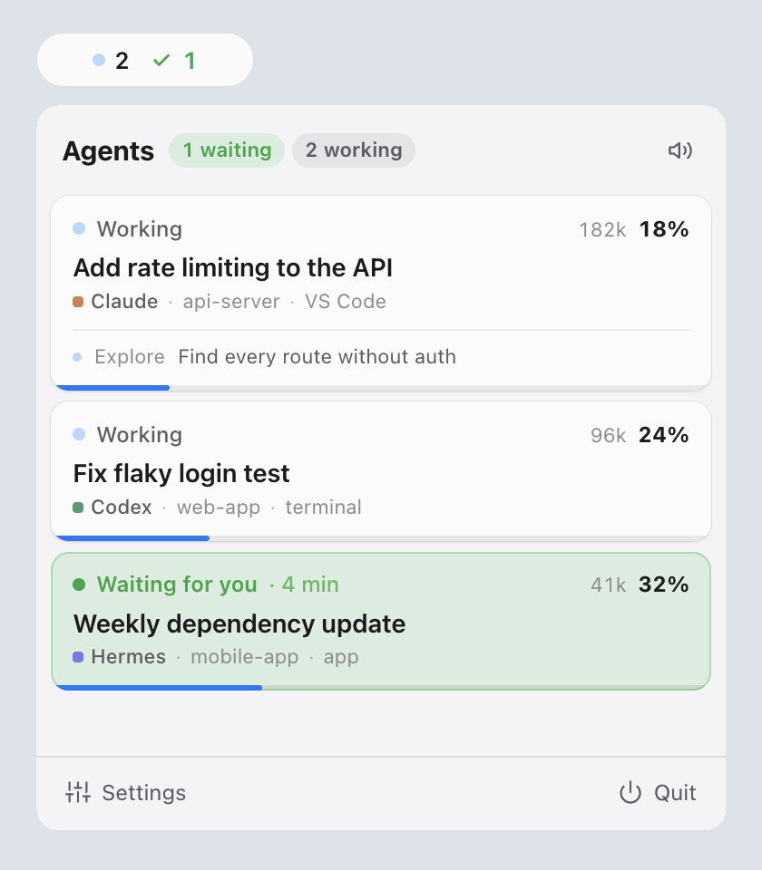

# agent-bar

**Плашка поверх окон на macOS: какие ИИ-агенты сейчас работают, а какие ждут тебя.**
Claude Code, Codex и Hermes — все сессии в одном списке, и звук, когда кому-то нужен ты.

[English](README.md)

<p align="center"></p>

## Зачем

Запустил агента, переключился на другое и забыл. Через двадцать минут оказывается, что он давно закончил — или всё это время ждал разрешения на команду. Когда сессий три-четыре в разных окнах, становится хуже.

agent-bar держит поверх всех окон маленькую плашку: сколько сессий работает, сколько ждут тебя. По клику — список.

- **Агентов не трогает.** Ни хуков, ни плагинов, ни правок в их настройках. Только читает файлы, которые агенты и так пишут на диск.
- **Claude Code, Codex и Hermes** в одном месте — из терминала, VS Code и приложения Claude.
- **Работает / ждёт тебя / нужен ответ.** Отдельный статус, когда агент посреди хода задал вопрос или ждёт разрешения.
- **Звук**, когда сессия закончила или спрашивает. Свои звуки, мьют одной сессии или всех. Не звенит, если ты уже смотришь на окно VS Code с этой сессией.
- **Нагрузка контекста** у каждой сессии, субагенты и фоновые задачи под карточкой.
- **Клик по карточке** открывает, где идёт сессия: окно VS Code, сессию в приложении Claude, терминал.

## Установка

1. Скачай `.dmg` в [Releases](https://github.com/nu-idea/agent-bar/releases/latest):
   [Apple Silicon (M1 и новее)](https://github.com/nu-idea/agent-bar/releases/latest/download/agent-bar-arm64.dmg) ·
   [Intel](https://github.com/nu-idea/agent-bar/releases/latest/download/agent-bar-x64.dmg)
2. Перетащи **agent-bar** в «Программы».
3. Открой. В первый раз macOS его заблокирует — см. ниже.

### Первый запуск: «Не удалось проверить…»

Приложение не подписано платным сертификатом Apple, поэтому в первый раз macOS его не откроет. Есть два способа:

- попробуй открыть один раз, потом **Системные настройки → Конфиденциальность и безопасность**, прокрути вниз и нажми **«Всё равно открыть»** рядом с agent-bar, подтверди паролем;
- или один раз выполни в Терминале:
  ```bash
  xattr -dr com.apple.quarantine /Applications/agent-bar.app
  ```

Дальше открывается как обычно. Исходники здесь же, можно [собрать самому](#сборка-из-исходников).

## Что нужно

- macOS 13 или новее, Apple Silicon или Intel
- хотя бы один агент: Claude Code, Codex или Hermes

## Приватность

Всё работает локально, в сеть виджет не ходит. Читает только файлы агентов (`~/.claude`, `~/.codex`, `~/.hermes`) и `storage.json` VS Code, пишет только свои настройки и журнал. Разрешений macOS не просит. Подробная таблица — в [английском README](README.md#privacy).

## Сборка из исходников

```bash
git clone https://github.com/nu-idea/agent-bar.git
cd agent-bar
npm install
npm start          # запустить
npm run dist       # собрать .dmg и .zip в dist/
```

Как всё устроено внутри — [docs/ARCHITECTURE.md](docs/ARCHITECTURE.md).

## Лицензия

[MIT](LICENSE)
